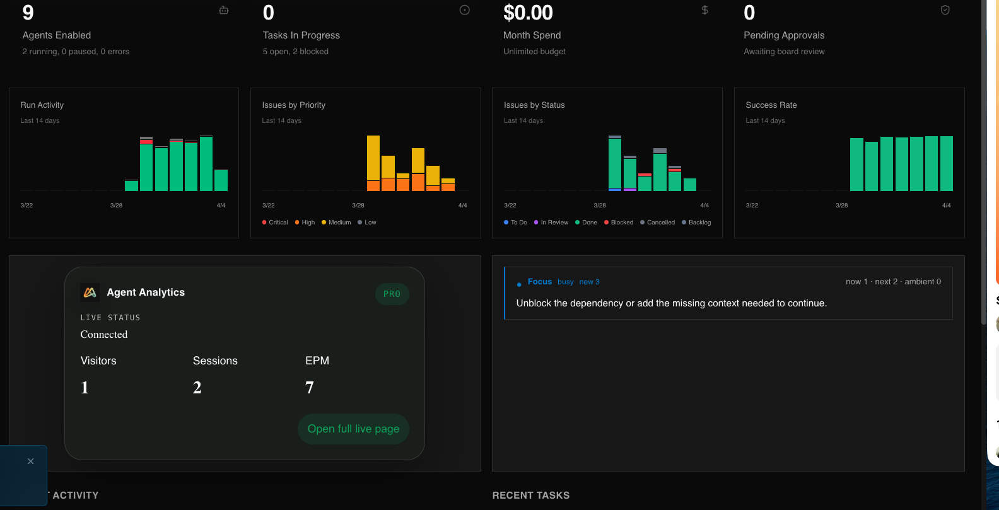

# Agent Analytics Live for Paperclip

Agent Analytics Live is the Paperclip plugin for operators who want live web activity where they already run the company.

It brings a company-level live monitor, a dashboard widget, and a sidebar entry into Paperclip so teams can answer one question quickly:

Which company asset is moving right now, and is that movement worth attention?

The important setup rule is that this is a multi-company plugin: each Paperclip company keeps its own plugin configuration and chooses its own Agent Analytics project.

Docs:

- [Set up Agent Analytics for your Paperclip company](https://docs.agentanalytics.sh/guides/paperclip/)
- [Paperclip Live Plugin](https://docs.agentanalytics.sh/reference/paperclip-live-plugin/)
- [Operator overview](./docs/operator-overview.md)
- [Setup and auth](./docs/setup-auth.md)
- [Asset mapping guide](./docs/asset-mapping.md)
- [Live behavior](./docs/live-behavior.md)
- [Limits and troubleshooting](./docs/limits-and-troubleshooting.md)
- [Maintainer notes](./docs/MAINTAINER.md)

## Install in Paperclip

1. In Paperclip, open `Settings` -> `Plugins`.
2. Click `Install Plugin`.
3. Install this package:

```text
@agent-analytics/paperclip-live-analytics-plugin
```

4. Open the plugin `Configure` page.
5. If the account is not set up yet, use the Paperclip setup task shown in the plugin help panel or the docs guide first.
6. Log in with your existing Agent Analytics account in the browser.
7. In that company workspace, choose the Agent Analytics project from the plugin settings page.
8. Open the company live page from the sidebar.

If you run multiple Paperclip companies, repeat those steps in each company workspace. The selected project is per company, not a single global plugin setting for the whole Paperclip instance.

## Screenshot



## Requirements

- An existing Agent Analytics account with live-read access
- A Paperclip instance with plugin support

`/stream` and `/live` are live routes, and `/live` is paid-only. The plugin is intentionally a live monitor, not a historical reporting surface.

First-time Agent Analytics setup for Paperclip should be driven by the Paperclip task flow in the docs guide, not by this login popup:

[Set up Agent Analytics for your Paperclip company](https://docs.agentanalytics.sh/guides/paperclip/)

## What ships today

- `page`: company-level live map and evidence view
- `dashboardWidget`: compact live status summary
- `sidebar`: left-nav entry that opens the live page
- `settingsPage`: existing-account browser login, per-company project selection, Paperclip setup help, and advanced plugin settings
- Worker-owned auth, `/live` polling, `/stream` fan-out, and company-scoped cache/state

## Install from the CLI

```bash
npx paperclipai plugin install @agent-analytics/paperclip-live-analytics-plugin
```

After install, finish connection and choose the Agent Analytics project from the plugin settings page for that company workspace.

## Local development

```bash
cd paperclip-live-analytics-plugin
npm install
npm test
npm run build
npm pack
```

- `npm test` exercises the worker/shared logic.
- `npm run build` produces the Paperclip worker, manifest, and UI bundle.

Helpful local commands:

```bash
npm run pack:local
npm run reinstall:local
```

## Publish

```bash
cd paperclip-live-analytics-plugin
npm install
npm test
npm run build
npm publish --access public
```

The package is configured for public scoped npm publishing.

## Repository layout

- `src/worker/`: auth, live polling, stream fan-out, and company-scoped state
- `src/ui/`: page, widget, and settings UI
- `src/paperclip/`: Paperclip-specific manifest and entrypoints
- `docs/`: operator and maintainer notes
